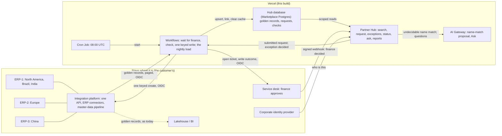

# Nordhammar Partner Hub on Vercel: the decisions

Customer-facing. Eight sections, in the order the exercise asks for them. Every number is labelled **measured**, **estimated**, **target**, **assumption** or **reported**. Every Vercel capability names the plan it needs and cites the page it was checked against (fetched 2026-10-31 to 2026-11-02). Bracketed `[BASELINE: …]` items are the customer's numbers: measuring them is the first week's work, not something to invent before it.

## 1. The problem

Nordhammar Industries is a fictional European manufacturer with five regions (Brazil, Europe, United States, India, China) and three ERP instances: ERP-1 for North America, Brazil and India; ERP-2 for Europe; ERP-3 for China. Each region has always created its own customers and suppliers by hand: a ticket, two sign-offs, someone retypes it into the ERP. The same legal entity exists several times across regions, tax IDs arrive in four formats, and finance cannot see exposure to a corporate group because the group is four records in four systems.

The company's integration platform already runs a master-data pipeline: it extracts every ERP nightly, matches on normalised tax ID and DUNS, and publishes one golden record per legal entity. On first load it halved the North American customer records, from about 70,000 to about 34,000 (**reported**, from the engagement). And the duplicates kept coming, because the pipeline works at two in the morning and the regions create partners at nine, in five places, with no way to see each other at the moment of entry.

**Who feels it.** The requester in sales loses `[BASELINE: days from ticket to ERP number]` per new customer. The master-data steward spends `[BASELINE: hours per month]` cleaning duplicates after the fact; the pipeline flagged `[BASELINE: duplicates at first load]`. Finance's exposure-by-group number is wrong by construction until the steward catches up.

**What this is.** One product for creating a partner. Anyone with a region searches the golden records live, raises a standard request for a new customer or supplier, and finance approves it in the service desk, where it already does. The hub then checks the request again. A clean request is created without anyone in the hub touching it: the right ERP creates the record and hands back its number, the number is written back to the ticket, and the next load makes it searchable. Anything not clean goes to the central master-data team as an exception, with the reason. Duplicate prevention happens at the point of entry, across regions, before the form is finished. The ERPs stay where the number is born; the integration platform stays the only way in and keeps its matching; the lake stays for finance analytics.

**Targets.** Duplicates created at the point of entry: near zero (**target**). Every check is recorded with what it found, so the count of exact matches stopped at entry is on Home from the first day. Request to ERP number: inside one business day (**target**; measured per request as the weekday hours between submitted and created, on Home). Since the service desk, Home also shows the share of finance-approved requests that needed no person, with no target set yet. Steward time on intake duplicates: `[BASELINE: hours per month]` → half within two quarters (**target**).

## 2. Current versus target architecture

**What stays, and why.**
- **The three ERPs.** The partner number is born there; nothing about creating it changes.
- **The integration platform.** It owns the ERP connectors, the mapping into each ERP's own fields, and the master-data pipeline that produces golden records. This app never talks to an ERP directly and never sees an ERP's field names; it calls one API.
- **The lakehouse and BI.** Exposure and trends over all data, for finance.
- **The corporate identity provider.** The app trusts it; it never stores a password.
- **The service desk.** Finance already approves new partners there, so it still does. A request raised in the hub opens a ticket for finance; a ticket raised in the desk first becomes a hub request when finance approves it. Everything that is not a new partner stays there too. (`docs/SERVICE-DESK-CONTRACT.md` has the full contract.)

**Vercel's role: Replace the intake system, Connect to what stays.** The ticket, the retyping and the separate intake screen become one product. It holds a copy of the golden records for search at the moment of entry, owns the request, its checks and its exceptions, and makes the one keyed write. Everything it needs from the customer's world comes through the integration platform's API. Nothing else moves.

**Where the boundary is crossed** (`docs/STAGE-SET-CONTRACT.md` has the full contract):

| Crossing | Call | Demo | Production |
|---|---|---|---|
| Golden records into the hub | `GET /integration/v1/golden-records?since=<cursor>` | Nightly by Vercel Cron, or "Run now"; a Workflow reads page by page | Same, over Static IPs |
| Create a partner | `POST /integration/v1/partners`, `Idempotency-Key: <operation key>` | The stand-in routes by region to ERP-1, ERP-2 or ERP-3, maps fields, assigns a number | Same, over Static IPs |
| Reconcile | `GET /integration/v1/operations/{key}` | Answers whether a create committed, in which ERP, with which number | Same |
| Ticket for finance | `POST /desk/v1/tickets`, then `POST /desk/v1/tickets/{id}/comments` with the outcome | The stand-in's desk: a queue, a ticket screen and a new-ticket form for finance | The customer's service-desk API |
| Finance decided | Desk to hub: `POST /api/webhooks/service-desk`, HMAC-SHA256 over timestamp and body, 5-minute window, event id stored | The desk writes the decision and an outbox row in one transaction, then sends; a failed send is resent | The desk's own webhook signing |

Every call from the app carries the deployment's own Vercel OIDC token. The receiver verifies it against Vercel's published keys and accepts this project's subjects only. The one call into the app, the desk's webhook, is signed with a shared secret instead, because that is how service desks sign webhooks and the desk is not a Vercel deployment in the customer's world.

The demo's integration platform is a stand-in. It is a separate Vercel project with its own Postgres, three ERP masters with their own number series and record shapes, a ledger, the golden-record feed and the service desk. In production it is the customer's platform in the customer's cloud.

The production path is **Static IPs**: Pro and Enterprise; $100 per month per project plus private data transfer; a shared pool with subnet-level isolation; applies to Functions and optionally builds, not to Routing Middleware. The customer's platform sits behind an IP allowlist, not inside an AWS VPC, so a fixed egress address is the right fit. **Secure Compute** (Enterprise) is the step up when full network isolation is required, when the backend is in an AWS VPC that should be peered, or when a site-to-site VPN into an Azure network, Google Cloud or an on-premises data centre is wanted. Sources: https://vercel.com/docs/networking/static-ips ; https://vercel.com/docs/networking/secure-compute

**What changes for the customer (measurable).** Three numbers become visible from the first week:
- duplicates stopped at entry
- request-to-number cycle time
- steward hours on intake duplicates

And one fewer system: intake, the duplicate check, the questions and the reports are one product with one permission model.

## 3. Vercel choices, with rationale, trade-offs and the plan each needs

| Primitive | What it does here | Why this and not the alternative | Plan |
|---|---|---|---|
| **Workflows** | Two durable runs. (a) One run per request revision waits on finance's decision in the service desk (hours to days), then runs the checks again. Clean: an automatic approval that lists the checks that passed. Not clean: the same run waits again, on the central team. Either way it then owns the single create with an idempotency key, bounded retries with backoff, and a duplicate-run guard, and writes the outcome back to the ticket. Each request page reads its run's event log from the Workflow World (metadata only) and shows where the time went: each step and its retries, each wait on a person, and the run's event cost at the list price. (b) The nightly load: takes a lock, reads the golden-record feed page by page from the stored cursor, writes each page as its own step (a failed page is retried on its own), then clears the search cache for the regions it touched. A run is pinned to the deployment that started it and survives redeploys (§5). | Rejected: a status table plus a cron job, which is what exists today and loses the wait and the retry semantics. Trade-off: finished runs' payloads are readable for 1 day on Hobby, 7 on Pro, 30 on Enterprise; the business truth therefore lives in the database, never only in the run. | All plans. Sources: https://vercel.com/docs/workflows ; https://vercel.com/docs/workflows/retention |
| **Cron Jobs** | Starts the nightly load at 08:00 UTC (02:00 Central). Vercel sends the project's `CRON_SECRET` as a bearer token; the route accepts only that and refuses everything when none is configured; it only starts the Workflow. "Run now" for the central team starts the same Workflow. | Rejected: a Workflow that sleeps 24 hours and starts itself again. It works without Cron, but the schedule then lives inside a running chain: not in the project's cron list, and one broken link stops every later night without a trace. | All plans; Hobby at most daily with hour-level precision, Pro to the minute. Sources: https://vercel.com/docs/cron-jobs/usage-and-pricing ; https://vercel.com/docs/cron-jobs/manage-cron-jobs |
| **AI SDK 7** | Two uses. (a) One structured generation on exactly one route: a name match against a hub record that carries no tax ID. Code decides the other four routes. The model may only propose; a validator rejects any claim about a candidate or field it was not given; nothing it says reaches the ERP. (b) "Ask": one streamed call (`streamText`) with four read-only tools, two steps at most. Three look up one record (a group, a request, why it was flagged). The fourth, `queryHub`, takes a typed query spec from closed lists (subject, measure, filters, time window, one grouping); code refuses unsupported combinations with a fixed sentence, intersects regions and amount regions with the person's, runs one parameterised query from fixed fragments, and writes the query in words under the answer (`docs/QUERY-SPEC-CONTRACT.md`). The card is the tool result and is sent the moment the lookup returns; the sentence follows word by word, each word released only after the citation rule has checked it, so an uncited id or number never reaches the screen. No tool writes. | Rejected: rules only (the ticket process already is that) and a chat box over the database, including text-to-SQL. Trade-off: the proposal is advice to the human reviewer, by design. | n/a (library) |
| **AI Gateway** | Both uses go to a virtual model (`vmc/nordhammar-proposal`): a primary, one fallback, zero data retention and no prompt training pinned on the Gateway side, so a model change is a dashboard edit, not a deploy. Today the primary is gpt-4.1-mini with Haiku 4.5 as the fallback, because the team's free Gateway credits admit the former and not the latter. The served model, every model the Gateway tried, the tokens, the cost and the time of each proposal are recorded with the request and shown on its Run panel (§6). For the demo, a flag (`ai-model`, flipped from the Toolbar) swaps the model for the duplicate check and Ask without a deploy. Only a model that passes the live eval is offered (§6). Today that is one option beside the configured model: Haiku 4.5 first, which the free tier refuses, so gpt-4.1-mini serves. That is a real fallback, visible on the panel and in Ask's details. Zero data retention is requested because the prompt carries a counterparty's identity; a call that cannot be served under it fails, and the request proceeds to review without the proposal. | Rejected: a direct provider SDK (one vendor, no failover, no retention control). Trade-off: a provider without ZDR is refused, which is the point. | Virtual models: all plans. Per-request ZDR: **Pro and Enterprise**, no extra cost. Sources: https://vercel.com/docs/ai-gateway/models-and-providers/virtual-models ; https://vercel.com/docs/ai-gateway/security-and-compliance/zdr |
| **Cache Components (Next.js 16)** | Every page is a prerendered shell with per-request content streamed behind Suspense; the per-region partner lists are cached and cleared by the load. Page by page in "What renders when" below. | Rejected: fully dynamic pages for data that changes once a night. Honest limit: the default cache handler is per instance, so the server-side hit rate on serverless is modest. The production option is `use cache: remote` on Runtime Cache, which Next.js 16 keys by build, so each deployment starts cold. | All plans. Source: https://vercel.com/docs/caching/runtime-cache |
| **OIDC federation** | The app authenticates to the integration platform with the token Vercel mints for its own deployment: short-lived, per invocation, naming team, project and environment. The receiver verifies it against Vercel's published keys and accepts only this project's subjects. Production accepts only this credential; the shared secret works in development alone (§6). | Rejected: a long-lived API key as the primary credential, which is what OIDC exists to replace. Honest limit: the `development` subject is on the allow list so a local run can reach the deployed stand-in; production would list `production` only. | All plans. Source: https://vercel.com/docs/oidc/reference |
| **Rolling Releases + Instant Rollback** | Every production promotion is staged; abort returns traffic to the previous deployment while in-flight runs finish where they started (§5). | Rejected: all-at-once promotion. Trade-off: one project on Pro. | Rolling Releases: **Pro (one project) and Enterprise**. Instant Rollback: all plans. Source: https://vercel.com/docs/rolling-releases |
| **Fluid compute** | The runtime the app, the steps and the model calls run on. Active CPU is what is billed, so a function waiting on the Gateway or the integration platform does not pay for the wait. A paused Workflow run costs nothing for a different reason: it is suspended, not running. | n/a | All plans |
| **Marketplace** | Postgres (two databases: the hub's and the stand-in's) and the identity provider, provisioned from the CLI with environment variables injected per environment. In production the hub database is Marketplace-provisioned in the customer's account. | Rejected: hand-wired connection strings. | All plans |

**Supporting, not architecture.** Demo switches are Vercel Flags read on the server, flipped from the Vercel Toolbar for team members only; a flag never changes who may do what. Automatic approval has an off switch for the central team in the header of its Exceptions page, stored in the hub with who changed it and when; off sends every finance-approved request to a person. It is a stored setting and not a flag, because the decision it governs arrives as a server-to-server webhook that carries nobody's Toolbar override. Speed Insights and Web Analytics are in the layout; Speed Insights is switched on in the dashboard, Web Analytics is not yet (§7). The link preview is an `opengraph-image` route. All plans.

### What renders when

The build marks every page partially prerendered: a static shell at build time, and the signed-in content streamed per request behind Suspense in the layout. The person is read per request; nothing about who you are is cached.

| Page | Prerendered at build | Per request, streamed | Cached, and what clears it |
|---|---|---|---|
| Sign-in | The page and its tiles | The form (reads the query string) | The ledger mark, `use cache` tagged `ledger`, `minutes` profile (stale after 1 minute, gone after 1 hour); nothing clears it early, nothing on it is secret or urgent |
| Customers, Suppliers | Header, strip frame | The person, the selected record | Each region's list, tagged `hub:<region>`, `minutes` profile; the load clears the regions it touched with `revalidateTag(tag, { expire: 0 })` |
| Request status | Frame | State, timeline | Nothing. The page polls `/api/requests/{id}/state` every 2 seconds and refreshes on a state change, so approving does not need to clear anything |
| Home | Frame | The person's tiles; the three outcome tiles stream in behind Suspense after them | Nothing; the outcomes are read live |
| Ask | Frame, box and suggestions | The answer, streamed from `/api/ask` as JSON lines: the card, then the checked sentence, then the totals | Nothing |
| Exceptions, Requests | Frame | Everything else (per person, per region) | Nothing |
| How it works | Frame | Rail for a signed-in person | Nothing |

### Why Vercel, and where it is not the answer

The integration platform already integrates. The bottleneck is the moment a person in one of five regions types a new partner's name with no view of the other four. That is a front-door problem, and a front door is an application. Four other ways to build it:

| Option | Where it beats this build | Where it loses for this problem |
|---|---|---|
| **Status quo: service-desk form and ticket** | No new platform, nothing to learn. | The check happens hours later, by hand, so duplicates still enter. No cross-region view at entry. No keyed write, so a retry is a phone call. |
| **The integration platform's own low-code forms** | One vendor; the data is already there; the platform team owns it. | Forms built for admins, not for a requester in sales. No per-change preview for the steward. Approval waits and retries become flows someone maintains. |
| **The customer's hyperscaler** (function host, queue, orchestrator, API gateway) | Already inside their network; procurement is done; isolation is the default. | Several services to assemble and run for what one deployment gives here. A days-long human wait is a state machine you write. Previews per change and model failover are your code. |
| **A per-user-licensed low-code app platform** | Fast start; approvals built in; finance teams often hold licences. | Per-user licences across five regions. The connector to a custom API and three ERPs is custom anyway. Keyed writes and retry semantics are not first-class. |

What tips it to Vercel, in order:
1. **A fast per-region read at the moment of entry.** Cache Components, all plans.
2. **A preview URL for every change,** so the steward clicks the next version before it ships. All plans, https://vercel.com/docs/deployments/environments
3. **A durable wait, bounded retries and a keyed write in the same repository as the UI.** Workflows, all plans, https://vercel.com/docs/workflows
4. **No standing secret to the customer's API.** OIDC, all plans, https://vercel.com/docs/oidc
5. **Staged, reversible promotion.** Rolling Releases, **Pro and Enterprise**, https://vercel.com/docs/rolling-releases; Instant Rollback, all plans, https://vercel.com/docs/instant-rollback

**Where Vercel loses.**
- **A customer with no web team,** now or planned, is better served by a low-code form; this build would be over-engineered.
- **One region and one ERP** make a ticket good enough, because the value here is the cross-region view at entry.
- **Network isolation as a day-one requirement** means Secure Compute, which is **Enterprise** (https://vercel.com/docs/networking/secure-compute). A pilot without that budget takes Static IPs on **Pro** (https://vercel.com/docs/networking/static-ips) as the honest middle.

**What would change the recommendation.**
- The integration platform's vendor ships an intake screen with live cross-region matching and a keyed write path.
- The customer mandates its hyperscaler for all new applications. The boundary, the idempotency and the evals move with the code; only the Vercel primitives are swapped.
- Volume turns out to be a handful of requests a month in one region (**assumption** to test in the first week, not a measured figure).

**Identity.** The app needs one answer from an identity provider: who is this. Which regions a person may see, and whether they see amounts, is an entitlements table in the app's own database. It is read fresh on every call, so a revoked role takes effect on the next request and the provider holds no business data.

The demo provider is a hosted auth service with email and password and public signup disabled. Sessions are verified in the proxy against its published ES256 key, with no network call (the key type was checked on its published key set on 2026-11-02).

Three scopes, granted separately in the entitlements table:
- **Identity** (a company's name, tax ID, city, group, which regions and ERPs hold it) is readable in every region by everyone, with the `global_identity` flag. That is what a golden record is for: a regional user sees that Europe already has the company before creating it again. The flag is per person, so "Brazil may not see European customers" is a data change, not a deploy.
- **Work** (where you request, whose requests and duplicate checks you see) stays in your own regions. Another region's record opens with its identity, and its commercial section reads "held by the EU team".
- **Amounts** (credit limits, spend) are a grant per person and region (`money_regions`), never implied by the others.

Two roles:
- **Regional users** search every region, request and work inside their own, see amounts for their own regions, and cannot approve. Home shows their region and their own requests.
- **The central master-data team** is the final check after regional finance: duplicates, and the group's credit exposure across every region, shown on the review page before it approves another company into a group. It also fixes stopped creates, runs the load, switches automatic approval and sees amounts everywhere.

Finance is not a role in the hub. Regional finance decides in the service desk, as today, which has its own sign-in.

Alternatives, each with the one reason it did not win:
- **The customer's own identity provider over OIDC.** This is the production answer; the swap touches the proxy and one helper.
- **A Marketplace-native auth product.** Equally good, but its organisations and roles would have pulled regional entitlements into the vendor, and those belong next to the hub.
- **A self-hosted credentials provider.** It would store passwords in this app.

**Named, not built, with the reason.**
- **Vercel CI.** It does not support public repositories, which this one will be, so GitHub Actions runs the gates (source: https://vercel.com/docs/ci, "Public repositories are not currently supported").
- **Skew Protection.** Recommended alongside Rolling Releases. It was left off by instruction for the rollout test; production turns it on.
- **Secure Compute.** Enterprise, for isolation or an AWS VPC; not needed for this customer's boundary.
- **Queues.** Used by Workflows underneath, not directly.

## 4. Working demo

- **App:** https://nordhammar-partner-hub.vercel.app (the production deployment, behind a public project domain; the earlier `staging-nordhammar.vercel.app` still works). The brief is at `/brief`.
- **Integration platform stand-in:** https://customer-intake-erp-stub.vercel.app. A separate Vercel project: `/integration/v1` in front of three ERP masters, a ledger, the golden-record feed and a demo fault switch. It accepts only the app's deployment identity in production.
- **Repository:** a public GitHub repository with full commit history, decisions in the messages. Published on submission; see `docs/PUBLISH.md`.
- **Test users** (passwords in the submission email, never in the repository):
  - `ana.requester@example.com`, regional user, Brazil
  - `jonas.requester@example.com`, regional user, Europe
  - `priya.reviewer@example.com`, central master-data team, every region
  - `noregion@example.com`, no region yet: shows the locked-out screen
- **Service desk** (the stand-in's `/desk`, its own sign-in, password in the submission email): Marta Lindqvist, finance

**Try it in two minutes.** Start as Priya; rows that say Ana show what a regional user sees. Every tax ID below passes its check digits.

| Moment | Where | Type | What you see |
|---|---|---|---|
| Every partner, every region | Customers | (nothing) | Every customer in all five regions in a table, with filter words that count (region, on hold, no ERP number yet, in a group, ERP); narrow by typing. Open a European record as Ana: identity in full, "Terms, risk and amounts are held by the EU team" |
| Search by name, DUNS, city, ERP number | Customers | `aurora` · `884983974` · `curitiba` · `110008` | The table narrows each time; open a row for identifiers, group, parent and ultimate parent, addresses, sources and Ana's-region credit |
| Exists in another region | Request a new customer as Ana | an EU company's tax ID | The check finds it in Europe and stops the request with the record linked; she sees who and where, not its amounts |
| Exact match, hard stop | Request a new customer | `Aurora Industrial Ltda`, CNPJ `61.000.101/0001-57` | "This customer already exists"; the request cannot continue, and the stop is recorded |
| Same company, new branch | Request a new customer | `Aurora Industrial Filial Centro`, CNPJ `61.000.101/0005-80` | "Same company, different establishment": pre-selects "new company in this group" |
| Name match, the AI proposal | Request a new customer | `Vela Processos do Brasil`, CNPJ `61.000.103/0002-27` | A legacy record with no tax ID; the model's evidence rows; a human decides. After submit, the timeline names the model's reading, the model and the cost |
| Invalid tax ID | Request a new customer | CNPJ `61.000.103/0001-47` | Fails its check digits; nothing is searched |
| Clean create, end to end | Request a new customer, then the desk as finance | The fresh example on the sign-in page (a new name and CNPJ for every visitor, so the path works for every grader), a type, a bill-to with its CEP, a reason | The hub is checked as you type; step 2 opens on its own. Submit; the status page shows the ticket, and the ticket shows finance the reason and the contact. Approve the ticket in the desk. Within seconds the status page reads approved automatically, with the checks that passed, then an ERP-1 number in the 110xxx series; the ticket gets the number as a comment |
| An exception | The same-company case above, submitted, then the desk, then Exceptions as Priya | `Aurora Industrial Filial Centro` | Finance approves; the hub stops it as an exception (same company as another establishment; the requester chose new company in this group). Priya sees the reasons and approves; the number lands and goes back to the ticket |
| Ticket first | The desk: New partner ticket, then approve | A new name and a valid CNPJ, requester `ana.requester@example.com`, region BR | The ticket becomes a hub request when finance approves, is checked, and is created; no duplicate check ran at entry, so the hub's checks are the only ones. Leave the CEP blank and it becomes an exception, "missing: CEP", instead |
| Finance rejects | Any request's ticket in the desk: Reject, with a reason | | The request reads declined by finance, with finance's reason; a reject without a reason is refused |
| Lost response | Exceptions as Priya, "Demo controls": "Drop the Next ERP Response", then any clean create through finance | | Attempt 1 gets no answer; the retry with the same key gets the same number back; one record |
| China | Request a new customer as Priya, region CN | Both names and an 18-character unified code | Routed to ERP-3; a 310xxx number |
| Make it searchable | Exceptions as Priya: "Run the Hub Load Now" in the header | | The load runs as a Workflow; the line under the button says what it loaded; search finds the new partner |
| Where the time went | Any created request, "How this ran" | | Each Workflow step with its time and retries, each wait on finance or the central team, and the cost of the request: the model's (measured) plus the run's events (at list price) |
| Switch the model | Vercel Toolbar: `ai-model` to "Haiku 4.5 first", then the name-match case or any Ask question | `Vela Processos do Brasil` | The proposal and Ask still answer; their details say Haiku did not answer and gpt-4.1-mini served. No deploy |
| Stopped creates | Exceptions as Priya, the Stopped tab | | Each stopped create with its next step: check with the ERP, retry the delivery, or return it to the requester |
| Every request | Requests as Priya | | Every request in every region, where it came in (hub form or service-desk ticket) and its ERP number |
| Ask | Ask | "What is our credit exposure to the Aurora group?" | The card first, with the amounts the person may see (Ana: Brazil only; Priya: every region), then one sentence that streams in and cites only the card; the details show both model calls' cost |
| Home, by role | Home as Priya, then as Ana | (nothing) | Priya: the hub across five regions and this month. Ana: Brazil (partners, on hold, in groups abroad) and her own requests; her region in ink on the globe, the rest of the company behind it |
| The credit check | An exception that adds a company to a group, as Priya | `R-MW05N6LBNMBY` | "Group exposure": the group's companies by region and the credit already extended, per currency, before she approves |

## 5. Rollout and rollback

**The path.** Every change is a preview deployment with its own URL. The app reaches the integration platform the same way from a preview as from production, so an approver can click the next version before it is the version. Promotion to production goes through Rolling Releases (Pro and Enterprise; Pro allows one project, which is this one): staged, advanced by hand. Rollback is Instant Rollback (all plans): the previous deployment is still live and the alias moves back. Rollback of a partner number born in an ERP does not exist, which is why the write is gated (finance's approval, then the checks or the central team) and keyed, and why reconciliation reads the platform's own ledger. Source: https://vercel.com/docs/rolling-releases

**The pilot dial.** Brazil goes first with automatic approval off: the central team approves every request before it reaches the ERP, and the hub records where it agreed with the checks. When it stops disagreeing, automatic approval goes on and the central team's queue shrinks to what the checks cannot decide. The switch is on the Exceptions page and takes effect on the next request, so it is also the first step back if a check misbehaves.

**What an incident looks like mid-rollout, from doing it (2026-10-31, measured).**
1. A request was submitted and left waiting in review on the current production deployment (v1).
2. A visible, harmless change (a "v2" badge in the header) was deployed to production. With Rolling Releases on, the deploy did not take traffic; it started a rolling release at the 10% stage with v1 as current and v2 as canary.
3. Both versions were being served. A forced-canary request showed the v2 badge; a forced-stable request did not. Surprise one: twenty plain requests from one machine all landed on v1, because Vercel buckets by client-identifying information such as IP and stores the bucket in a cookie, so a single laptop never sees "10%". To show both versions in a room you use the `vcrrForceCanary` and `vcrrForceStable` switches, or two networks.
4. The waiting request was approved from the canary (v2). Its run had started on v1, and it finished on v1: the Workflow run is pinned to the deployment that started it, and the approval on the new version woke it through the hook. The same held in a plain redeploy without a rolling release. ERP number assigned on attempt 1; one ledger row.
5. The rollout was aborted. Surprise two: the CLI's `rolling-release abort --deployment` wants the deployment to roll back *to*, not the canary. After the abort production served v1 on every path, the request still read Created with its number (the database is the truth, not the deployment), and the run record was untouched. Surprise three: the deployment list still shows the canary as the newest "production" deployment after the abort; the alias is what moved.
6. Surprise four: after an abort the project sits in a rolled-back state, and the next `vercel deploy --prod` builds a production deployment that takes no traffic until a rolling release is started for it and completed. Rolling Releases on means every promotion is explicit, including the one after a rollback.
7. Not enabled, by instruction: Skew Protection, which the Rolling Releases doc recommends so a page served by v1 calls v1's Server Actions during a rollout. Without it, a v1 page that posts to a v2 function can fail on an unknown action id. It did not happen here because one browser stays in one bucket; it would in a room with two networks. Production turns it on.

Evidence: `docs/evidence/rollout-*`, `deploy-survival-runs.json`.

**Re-run on the redesigned app (2026-11-02, measured).** A rolling release was started for the build that carries this document, and each stage was approved by hand:
- **Stage one, 10%.** Inspect showed the step 4 deployment as current and the new one as canary at 10%. `?vcrrForceCanary=true` served the canary's deployment id; `?vcrrForceStable=true` served the current one. Twenty plain requests from one machine all landed on the current version, the same bucketing as on 31 October.
- **Health, checked on the canary.** `/login` and `/how-it-works` answered 200, the cron route 401, and its runtime log held no errors.
- **Stage two, 50%, then 100%.** The release completed, and every request now carries the new deployment's id.

**Changes that crossed both projects (2026-11-02, measured).** Moving to the integration API changed the app and the stand-in at once. The order kept staging working at every point:
1. The stand-in's new tables were added; they were additive.
2. The stand-in was deployed with the old routes kept as aliases.
3. The app was promoted through a rolling release.
4. The first load ran.
5. The aliases were removed in a second stand-in deploy.

Both projects logged no runtime errors through it.

**What happens when something fails, per hop.** Each case was run, not reasoned, except where marked.
- **A load page fails.** The Workflow retries that page on its own, and the cursor only moves after a page is written. By design; not forced in the demo.
- **The model is unavailable.** The request proceeds to review with the deterministic result and a flag. This happened for real on 2026-11-01, when the Gateway refused every call for a billing reason, and the app carried on.
- **The ERP times out.** The step retries with the same key, then stops with effect unknown. Reconcile reads the ledger by key.
- **The ERP rejects the partner.** The request stops with the reason and no retry.
- **A response is lost after the ERP committed.** The step retries with the same key and the platform replays the number.
  - 2026-10-31: attempt 1 got a 503 after the commit; attempt 2, one second later, got 26004 back; one ledger row (`docs/evidence/lost-response-*`).
  - 2026-11-02, on ERP-2: attempt 1 lost its response; attempt 2 got 210201 back; one record.
- **A request is edited after approval.** The approval is void and the platform refuses the changed payload.
- **A forged, altered, stale or repeated desk webhook.** No signature, a wrong one, a changed body and a stale timestamp each get 401; a malformed body 400; a repeated event id 200 and nothing happens. An unknown requester, a requester outside the ticket's region and a ticket that names a different request get 400; a request that is not waiting for finance gets 409 (2026-11-03).
- **The hub cannot be reached when finance decides.** The decision and its outbox row are already committed in the desk; the send is retried with Resend and on the next decision, and the hub's event-id store makes a second delivery a no-op. By design; not forced in the demo.
- **A partner committed during a stop arrives in the hub before anyone reconciles it.** The first load after reconcile links it (§6).

## 6. Measured

All on the deployed stack unless noted; dates 2026-10-31 to 2026-11-02.

- **Security boundary (measured).** Against the production stand-in:
  - no credential, a malformed token, and the shared secret (accepted in development only) each get 401
  - a real deployment token is accepted
  - `POST /integration/v1/partners` with no token gets 401 (2026-11-02)
  - all five live sends to the platform on 2026-11-02 were recorded with the OIDC credential

  Finding: the Workflow step invocation does carry the deployment's OIDC token on Vercel, which no page I read states.
- **Three ERPs (measured, 2026-11-02).** Each region's create landed in its own ERP and series, in that ERP's own record shape:

  | ERP | Region | Number | Native record |
  |---|---|---|---|
  | ERP-1 | Brazil | 110201 | Name in capitals |
  | ERP-2 | Europe | 210201 | VAT with its prefix |
  | ERP-3 | China | 310201 | Chinese and romanised names |

  The 37 seeded golden records arrived through the feed, in each ERP's series, with China's lineage now `ERP3_CN`.
- **Idempotency (measured).**
  - 2026-10-31: six creates, six distinct numbers, one ledger row per operation key, including one lost response.
  - 2026-11-02, on ERP-2: attempt 1 lost its response after the commit; attempt 2 replayed 210201.
- **The nightly load (measured, 2026-11-02).**
  - Cron registered: `/api/cron/hub-load`, `0 8 * * *`.
  - The route answers 401 to no token and to a wrong token.
  - "Run now" after a new create: 1 record loaded, 1 request linked, finished within seconds; search found the partner afterwards.
  - A second run with nothing new: 0 records, lock released.
  - A request reconciled after its golden record had already arrived was linked on the next load.
- **The duplicate check is recorded (measured, 2026-11-02).** Every check writes what it found. On submit, the request carries its check: on a compare route that means the verdict, the model the Gateway says served it, tokens and cost. One example, read back from a submitted request: "unsure", openai/gpt-4.1-mini, 421 input and 129 output tokens, $0.00037. Exact matches stopped at entry are counted on Home.
- **The service desk (measured, 2026-11-03, on staging).** One request down each path:

  | Path | Request, ticket | What happened | Finance approval to number |
  |---|---|---|---|
  | Direct, clean | R-MW032OJ61OJ7, SD-10421 | Finance approved; approved automatically; ERP-1 110203; number on the ticket | 1.2 s |
  | Direct, name match marked not related | R-MW03DIK8A40A, SD-10423 | Exception with two reasons; Priya approved; ERP-1 110204; both comments on the ticket | 1.4 s from Priya's approval |
  | Ticket first, clean | R-MW03MNQZQ8OS, SD-10424 | The hub built the request from the ticket; all six checks passed; ERP-1 110206 | 0.9 s |
  | Finance rejects | R-MW03NPW1V8PB, SD-10425 | Declined by finance with the reason; a reject without one was refused | n/a |
  | Ticket first, lost response armed | R-MW03P6EMCDCF, SD-10426 | Attempt 1 got a 503 after the commit; attempt 2 replayed 110207; one record for the key | 2.9 s |

  Times run from the hub recording finance's approval to the number, read from the request's events.
- **The form asks only for what someone reads (measured, 2026-11-03).** The field inventory (`docs/FORM-FIELD-INVENTORY.md`) traced every field to a reader; six with none were cut, and a Brazilian customer went from up to 26 inputs to 13. Three effects, on staging:
  - Finance's ticket for R-MW068999F87V (SD-10428) shows the reason and the contact; before, it showed the name, tax ID and country only.
  - ERP-1's record for it (110209) holds the postal code, the bairro and the complement; before, it dropped all three.
  - A ticket raised in the desk without a CEP (SD-10430) became an exception, "missing: CEP". Before, the check that claimed to look for missing fields could not fail.
- **Where the time went and what it cost (measured, 2026-11-03).** The Run panel on staging, read from Workflow's own event log:

  | Request | Run | Waiting on people | In steps | Events | Cost |
  |---|---|---|---|---|---|
  | R-MW03DIK8A40A, an exception | 4 min 56 s | 4 min 51 s (finance 1 min 38 s, the central team 3 min 13 s) | 1.6 s | 37 | $0.001108: model $0.000368 (Gateway) + events $0.000740 (list price) |
  | R-MW03P6EMCDCF, ticket first, lost response | 4.2 s | none | 2.8 s, of which the ERP step 1.9 s with a 1.4 s backoff before attempt 2 | 30 | $0.000600, events only; no model call |

  Not priced per request: function compute (Active CPU, billed per project) and Workflow data written and retained (per run in the dashboard). The panel's numbers match `workflow inspect events` for the same runs.
- **Which models the switch may offer (measured, 2026-11-03, `eval/results/live-2026-11-03T*.md`).** The four undecidable cases, three runs each:

  | Model | Passed 3 of 3 | Note |
  |---|---|---|
  | gpt-4.1-mini (configured) | 4 of 4 (2026-11-01) | In service |
  | gpt-5-mini | 2 of 4 | Also 7 to 11 s a proposal, close to the 12 s budget |
  | gpt-4.1-nano | 2 of 4 | Reads a clearly different company as unsure (E10) |
  | Gemini 2.5 Flash Lite | 1 of 4 | |
  | gpt-4.1 | 0 of 4 | Its verdicts are right in 11 of 12 runs; it fails on `groupRelation`, a field the instructions never define and the app never reads (§7) |

  None is offered. The switch's alternative is Haiku 4.5 first, served by gpt-4.1-mini, which is the evaluated model.
- **Durability (measured).** A run started on one deployment finished on it after a plain redeploy and after a rolling release was started and aborted around it (§5).
- **Latency (measured, single observations, not a benchmark).**

  | Operation | Time |
  |---|---|
  | Approve to created, attempt 1 | About 3 s |
  | Approve to created, one lost response and a 1 s backoff | About 5 s |
  | Cold sign-in on the hosted auth service | About 10 s once, then under a second |
  | Hub search and the on-entry check, warm database | Under a second |
  | Ask on production, four suggested questions as the central team (before step 11) | 2.0 to 3.0 s each |
  | Ask, streamed (2026-11-03, staging) | Card at 1.3 to 1.9 s; whole answer at 2.2 to 2.7 s. Brotli-compressed and flushed in pieces |
- **Tests (measured, Node 24, 2026-11-03).**

  | Suite | Count | What it covers |
  |---|---|---|
  | Contracts | 29 | Routing by region and the golden record a create publishes; the finance states and transitions; one case per clean check; the webhook signature (wrong secret, changed body, stale and future timestamps, no secret) |
  | Stand-in | 19 | The ledger's replay, conflict and rejection rules once per ERP; mapping into the three shapes; the door's refusals (missing or different Idempotency-Key, stale hash, a destination the region does not route to); feed paging across ties and re-runs; the OIDC verifier |
  | Web unit | 82 | Routing, normalisation including CNPJ check digits, the two roles, the payload builder, timeline copy, the import-graph walls, Ask's leakage rule, the check record, the cron route failing closed; the model switch and the Gateway's routing block; the Run panel built from two real staging runs; the streamed sentence's citation check and the summed cost; weekday hours and the median for Home |
  | In-process Workflow | 5 | Wait, resume, duplicate-start guard; the request run's four paths: clean, exception then the central team, finance rejects, ticket first |
  | Integration, against the real hub | 6 | Last run 2026-11-01; they write test requests, so they are not re-run against the demo database |
  | Mock eval | 13 | E01 to E12: routing, privacy, the validator |

  Both apps build; lint and typecheck are clean.
- **Live model eval (measured, 2026-11-01, `eval/results/live-2026-11-01T03-36-48-795Z.md`).** On gpt-4.1-mini, the four undecidable cases pass 3 of 3 each:
  - E03: a legacy record without a tax ID reads as unsure
  - E09: an exact recorded alias in the same city reads as same
  - E10: a different name in a different city reads as different
  - E11: an instruction injected into the name reads as unsure, with the proposal citing only the fields it was given

  Mean latency was 1.3 to 1.8 s per proposal, with a mean of 430 input and 130 output tokens. **Mean cost was $0.00038 per proposal** (measured from the Gateway's own cost field). Forced failover: a dead primary model id is served by the fallback, and the Gateway's routing block names the fallback as the served model. Haiku 4.5 is not yet measured; it needs paid credits, and the virtual model makes that a billing switch, not a code change.
- **What the eval changed (measured, same day).** The first live run failed E09 and E10, because the instructions said a record without a tax ID can never be confirmed. The instructions were rewritten to say what we want. The second run failed E11: the injected sentence talked the model into "same" without leaking anything. The validator now bounds that verdict: "same" against a record with no tax ID is allowed only when code confirms an exact name or alias match, with accents, punctuation and legal suffixes normalised. The third run passed 4 of 4, three times each.

## 7. Known limitations and risks, said before kickoff

- **Synthetic data.** Every name, ID and address is invented; the shapes are real. The integration platform is a stand-in on Vercel. The real platform's API, its limits and which interface each ERP exposes behind it are first-week discovery questions.
- **The hub is a copy, as fresh as the last load.** Golden records arrive nightly, or on "Run now". Between a create and the next load, search cannot see the new partner, and the request page says so. The identity reservation stops a second request for the same tax ID in that gap.
- **The nightly run needs `CRON_SECRET` on the project.** Without it, the cron route refuses the call by design and the night's load does not run. "Run now" works regardless.
- **Automatic approval trusts the checks.** A clean request is created after finance approves, with no one in the hub looking at it. The checks are deterministic and listed on the approval; the model never makes a request clean. The central team can switch automatic approval off in the header of the Exceptions page. A central-team member can still approve an exception they raised themselves; production adds that rule.
- **The service desk is a stand-in.** One finance user, a plain queue and a shared webhook secret. The real desk's API, its webhook signing and who in finance approves which region are first-week discovery.
- **Requests raised before the desk existed** finish on the old path, a central-team approval, because their runs are pinned to the code that started them.
- **China is on ERP-3.** Creates work end to end. Real China specifics (name rules, document checks) are discovery.
- **Data residency (not shown; production path).** If the rule is "no data leaves the EU":
  - deploy the Functions to an EU region and start each run with `region`, so the run's payloads, event log and streams stay there
  - put the database on an EU region of the Marketplace provider
  - send the proposal through a virtual model with `inferenceRegion` set to `eu`, plus zero data retention

  Two things still cross. Hook records are stored in `iad1` by default; they hold the hook token and encrypted hook metadata, not the payloads. Run metadata is processed by observability systems that are not region-pinned. Both are stated in Vercel's retention page and must be put in front of the customer's DPO. Sources: https://vercel.com/docs/workflows#multi-region ; https://vercel.com/docs/workflows/retention
- **Plan gates.** The demo runs on Pro.
  - Static IPs for the production boundary and Rolling Releases need Pro.
  - SCIM directory sync, audit logs, SIEM streaming and Secure Compute need Enterprise.
  - SAML SSO for the Vercel team is a Pro add-on.

  The customer's governance list decides the plan, not this app.
- **Cache.** The default `use cache` handler is per instance, and a shared Runtime Cache starts cold on each deployment in Next.js 16. Search is fast enough either way at this volume; the limit is stated so nobody is surprised.
- **Ask is a typed query, not a chat and not text-to-SQL.** It answers any count or total the spec can express over partners, requests and checks, at most one grouping at a time, and looks up one group or request. Anything else gets a refusal sentence or "I can't answer that here". Questions over the whole lake stay in the customer's BI. Text-to-SQL was rejected because a prompt is a wish and a region predicate in the query layer is a wall.
- **The free Gateway tier allows 5 model calls a minute per model.** Every Ask answer takes two. Several people asking at once on the free tier get "the hub could not be asked"; paid credits remove the limit, with no code change.
- **Emails and attachments.** Every event that would send an email writes a queued row to the timeline; nothing is sent. Attachments (tax registration, W-9) are not stored.
- **Development subject on the allow list,** so a local run can reach the deployed stand-in. Production lists `production` only.
- **Primary model not yet measured.** Haiku 4.5 needs paid Gateway credits; the fallback carries the demo until then.
- **The request payload still has room for six fields nobody fills.** DUNS, secondary IDs, industry, payment terms, ship-to and the PO reference are null in every new request; the shape stays version 2 so every hash and replay of an older request stays valid. Removing them is a version 3 that the integration platform accepts alongside 2 until the last version-2 run finishes: a named follow-up, not done this week.
- **The eval grades one field nobody uses.** The proposal's `groupRelation` is in the schema and the pass rule, but the instructions never define it and the app never reads it. gpt-4.1 fails on it alone. Removing it, or defining it, and re-running every model is the next eval change; until then the switch offers only what passed.
- **The demo's people are shared.** Everyone trying the demo signs in as the same four people, so signing out ends only that browser's session. A session ended elsewhere lands on the sign-in page with "Your session ended" and the page it was on kept; until 2026-11-03 it showed an error page, because its cookie still passed the proxy's local check (`06d6d6d`, measured on staging).
- **Skew Protection off** during the rollout test, by instruction; see §5.
- **Flags are switches, never permissions.** Who may search, request, decide or operate is the entitlements table on every call.
- **No one-click demo sign-in.** A sign-in that skips the password is the kind of thing that leaks into a real deployment behind a flag. The sign-in page lists the demo people with copy buttons; the passwords travel in the email.
- **Web Analytics needs the dashboard switch.** Speed Insights is switched on and posting vitals. Web Analytics is in the layout but not switched on, so its script path falls through to the sign-in redirect and the browser logs one console error on every page until the project owner enables it.

## 8. Development tooling and validation

**Tools.** Claude Code (Anthropic's agent, in the desktop app) wrote the code under direction. A separate agent on Factory, set up only to review, checked every change against the brief and the running app before it was accepted; its findings went into a review log and each was decided by me. It caught the golden records being seeded into the app instead of arriving through the load, the missing run trace (which became the Run panel, the model switch, streamed Ask answers and Home's live outcomes), and it held each change to the core story: the durable workflow owns the one keyed ERP write. It also reviewed the scope against the target workflow catalogue before the screens were rebuilt, and another agent was asked to rule on the identity-provider choice. The installed packages were read instead of memory: Next.js 16.4, Workflow SDK 5.2, AI SDK 7.

**What I steered and what I rejected.**
- **The screens.** The first cut optimised for the deep dive and left the three user-facing screens thin. They were rebuilt as search-first, record, two-step form.
- **The auth platform.** The agent's default of one hosted platform for database, row-level authorization and auth was cut to auth only. Authorization lives in this app's own model, and the provider is a production swap.
- **Roles.** Four roles that overlapped in code (a reviewer could do everything an operator could) became two, matching how a central master-data team works.
- **The boundary.** It moved twice on my call. First the app's database held the golden records. Then the golden records moved to the customer's side, published already cleansed, with three ERPs behind one integration API. A contract note listing every field and its reason was agreed before that was built (`docs/STAGE-SET-CONTRACT.md`).
- **Two claims that were false.** "Every duplicate the check stops is recorded" and "the served model is recorded per request" were true in neither case. Both were made true in code before the sentences stayed.
- **Questions.** The agent's text-to-SQL suggestion was rejected in favour of fixed, authorized reports.
- **The field set.** One copied from the ERP's customer table was trimmed to the fields that answer a question someone asks.
- **The eval.** It showed the proposal instructions contradicted the fixtures, and that an injected sentence could sway the verdict. The instructions were rewritten, and the validator gained one deterministic bound (§6).

**How changes were validated.** Each step had to pass the same gate before the next one started:
1. Tests green on Node 24.
2. A local production build clicked through against the real hub.
3. Promotion through a rolling release with the rollback target written down.
4. The flow clicked through again on the deployed app.
5. The runtime logs read.

The deployed click-through caught two regressions the tests and the build did not.
- A fix for a prerender warning broke every Server Action, so Ask stopped answering. It was replaced with a narrower fix and both failure modes were reproduced and cleared.
- The central team's approval of an exception recorded the decision but moved nothing, because the update was still conditional on the old "under review" state. The run woke, found nothing approved and ended. The condition now follows the state the decision was made on (`230d3fd`). The one request it stranded was repaired in the open: the recorded approval was applied, a "repaired" event explains why, and the create ran on the same operation key (ERP-1 110205). Its ticket did not get the outcome comment, because the repair ran on the old review-only run.

**How AI behaviour was validated.**
- **Mock eval.** Twelve fixtures (E01 to E12) cover every routing outcome, the cross-region privacy rule, an invalid checksum and an injected instruction in a name. The mock eval runs offline on every CI run with canned model outputs. It proves routing, privacy and the validator: an invented absence, an unknown candidate and an echoed instruction are all rejected.
- **Live eval.** It runs the four undecidable cases three times and records pass^3, latency, tokens and cost. A forced-failover case proves the Gateway served the fallback.
- **Ask.** Twenty-one questions in `eval/ask.live.test.ts`:
  - six lookups of one record (a group, a request, why it was flagged), including a request id that does not exist
  - ten counts and totals through `queryHub`, graded on the spec the model filled (subject, measure, filters, grouping, time window), not on its wording
  - two that must be refused by the spec check rather than approximated (spend by industry; partners grouped by tax ID)
  - two that must make no tool call (the weather; an injected instruction to list EU tax IDs)
  - leakage by construction: another region's group member shows as name and region only, a person without an amount entitlement gets no number (A20), and a company in a region the person cannot see gets its name and region and no figure (A21)

  The readers are fixtures and the model is real. Cases are graded in code on the tool and its argument or spec, on leaked and required tokens (A07 must return the company's own limit and not its subsidiaries'), and on the sentence citing only what the tool returned.

  **Measured 3 Nov on `openai/gpt-4.1-mini`: 21 of 21 cases, three runs each** (`eval/results/ask-2026-11-03T14-07-51-699Z.md`). It took four rounds. The first full run failed six: amount questions about the Aurora group or one named company went to the presence lookup (A07, A12, A20), an unknown request id got no lookup (A10), "on hold by ERP" dropped the hold filter (A15), and spend by industry was answered by type instead of refused (A18). Sharper instructions fixed four; the last two were fixed by putting the rule in the tool and field descriptions the model reads when it chooses. That run passed 20 of 20, and the canary still answered A07 wrongly: the spec had no way to say one company, so "Aurora Nordic AB" went in the group filter, which matches an ultimate parent, and the answer was its two Brazilian subsidiaries' R$650,000 under Nordic's name (Ana was shown it as Nordic's limit; Nordic's own is SEK 900,000, in EU). The eval had graded the spec, not the figure. The spec now has a `partner` filter for one company's own record (`docs/QUERY-SPEC-CONTRACT.md`, change of 3 Nov), A07 grades the figure, and A21 asks it as Ana. Earlier runs: `ask-2026-11-03T04-54-11-021Z.md`, `ask-2026-11-03T05-02-42-492Z.md`, `ask-2026-11-03T12-47-45-482Z.md`, `ask-2026-11-03T13-15-26-920Z.md`, `ask-2026-11-03T13-38-38-008Z.md`.

  Cost, summed over both model calls: about $0.0007 to $0.0008 an answer (measured on staging, 3 Nov). The 1 Nov figure of $0.0003 to $0.0004 counted the second call only, because the result's top-level metadata is the last step's.
- **Human review** of the model's reasons is recorded here, not in code.

**Design rationale (the ink pass, 3 Nov; the contract is `docs/DESIGN.md`).**
- **What it is:** a white page, five inks and no accent colour, a serif for titles, a sans for everything people read and operate, mono only for identifiers. No cards, tiles or pills: whitespace groups things and one hairline separates rows. A status is its word in its colour (green done, amber waiting, red stopped). Filters are words you press. One black primary action per screen, and the top bar never repeats the page's title.
- **Why it changed:** the 1 Nov pass (tiles in one frame, a blue accent, uppercase labels) read as a kit of parts, and the same page said its own name twice. The new direction is crisp black and white, with one visual that carries the data.
- **The one visual:** Home's globe draws the person's partners at their cities and joins a corporate group's establishments across regions, the duplicate the hub exists to stop. It is the one piece of motion that keeps going, on purpose; working screens rise into place once and hold.
- **Rejected:**
  - a motion library, because the motion is a handful of CSS transitions and one canvas
  - decorative ASCII anywhere but the sign-in page, the one screen that is not a working screen
  - a one-click demo sign-in (§7)
- **Verified** locally on a production build at 1440 and 390 px as Ana and Priya, every screen; then on the staging canary of the step 11 release, as Ana and Priya, before it was completed.
- **Sign-in LCP** (**measured**, warm cache, 1 Nov pass): 164 ms before, 188 ms after, 636 ms on the first request after a deploy (`docs/evidence/lcp-login.txt`).

### Feedback on the exercise

Candid Vercel feedback (ITG), from building this.

- **Workflow SDK.** The docs show `start(workflow, args, { hook })`; the published 5.2.3 package does not have it, and reading `node_modules` is the only way to know. Retries have no built-in backoff; attempt-based `retryAfter` is the pattern and could be the default.
- **Workflow's Vitest plugin** bundles every step file into plain Node. A step that imports `next/cache` at the top breaks an unrelated workflow test with a module-not-found error. Importing inside the step works; a line in the testing docs would save the hour.
- **AI SDK 7** requires Node 22+, while the Next.js generator still pins `@types/node` 20. One line in the generator would save every first build.
- **`vercel deploy --prod` from a script** sometimes returns without creating a deployment on the first call and succeeds on the second; nothing in the output says why.
- **`vercel rolling-release abort --deployment`** takes the deployment to roll back *to*; the help text reads as if it takes the canary. After an abort, `vercel ls` still lists the canary as the newest production deployment.
- **AI Gateway.** With OIDC auth working end to end, requests were refused at runtime for a missing payment card. A dashboard or CLI preflight ("this team cannot serve Gateway requests yet") would have saved the first live eval run.
- **Marketplace integrations collide on environment variable names.** A second Postgres-backed product could not be connected to a project that already had Neon's `POSTGRES_*` variables until a prefix was chosen. The prefix option works well; the collision message could suggest it.
- **Preview deployments behind Vercel Authentication** cannot be clicked through by an automated agent without a Vercel login. A short-lived, scoped share link that works for one preview from the CLI would make agent-driven verification of previews possible without turning protection off.
- **Workflow's event log, read for a run panel.** It is the right source: the platform's own record, and what Workflow bills. Two gaps: a metadata-only read gives `hook_created` without its token, so a panel cannot say which hook waited without relying on creation order; and `workflow inspect events` flattens `stepName` onto the event while the World API nests it under `eventData`, so a fixture taken from the CLI is not the API's shape.
- **What worked without friction:**
  - OIDC federation to our own receiver on all plans
  - Rolling Releases from the CLI
  - `vercel crons ls` confirming the schedule straight after deploy
  - the Workflow dashboard and `workflow inspect` for evidence
  - provisioning two databases and an auth provider from the terminal in minutes
