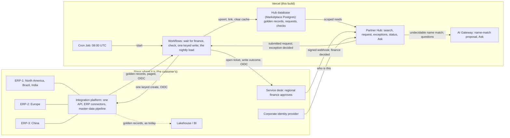

# Nordhammar Partner Hub: the decisions, and how each was tested

The customer-facing story (problem, value, rollout) is the brief, at `/brief` on the app. This file is its technical companion: what was decided, what was rejected, the trade-off accepted, and the evidence. It is organised around the four areas a deep dive goes into: delivery and rendering, the release path, AI and agents, and compute and connectivity.

Every number is labelled **measured**, **target**, **assumption** or **reported**. Every Vercel capability names the plan it needs and the page it was checked against (2026-10-31 to 2026-11-03). Items in `[BASELINE: …]` are the customer's own numbers; measuring them is week one, not something to invent.

## 1. The shape, and what it is judged against

**The flow.**
1. A regional user (Ana, sales operations in Brazil) searches every region's golden records and, if the company is not there, requests it. The duplicate check runs while she types; an exact tax-ID match stops her.
2. The hub opens a ticket in the service desk and waits. Regional finance approves there, as it does today, and the desk answers with a signed webhook.
3. The hub checks the request again, right before the ERP: the ERP's own duplicate check, where it has one, sees only its own instance, and the hub's sees every region.
4. Clean: one keyed create through the integration platform, which routes to the right ERP. Not clean: the central master-data team decides, with the reason and, for a new company in an existing group, the group's credit exposure in every region.
5. The number goes back on the request and the ticket; the next nightly load makes it searchable.

A ticket raised directly in the desk becomes a hub request when finance approves it and follows the same path, so a region that has not switched keeps working.

**What stays, and why.**

| System | Why it stays |
|---|---|
| Three ERPs | The partner number is born there; nothing about creating it changes |
| Integration platform | It owns the ERP connectors, each ERP's field mapping and the pipeline that publishes golden records. The hub calls one API and never sees an ERP's field names |
| Service desk | Regional finance already approves there, among dozens of request types. Moving finance into a new tool is the most expensive change you can ask of a customer, so the hub goes to finance, not the reverse |
| Identity provider | The hub asks only who someone is; it never stores a password |
| Lakehouse and BI | Analytics over all data. The hub answers operational questions, not the whole lake |

**The role: Connect.** The hub is a Vercel-hosted application that uses the systems that already matter (the integration platform, the service desk, the identity provider). What it replaces is a manual process (ticket, sign-off, retype, 2 a.m. cleanup), not a system; the only platform layer Vercel replaces is the release pipeline, previews, scheduler and durable queue a custom app would otherwise need. Until 3 November this said "replace the intake"; the final review pointed out that by the exercise's own definitions nothing in the stack is replaced. Everything it needs from the customer's world comes through one API (`docs/STAGE-SET-CONTRACT.md`) and the desk's webhook (`docs/SERVICE-DESK-CONTRACT.md`).

**Who sees what: three scopes, granted separately per person in the hub's entitlements table.**
- **Identity** (name, tax ID, city, group, which regions and ERPs hold a company) is readable in every region by everyone, through a per-person `global_identity` flag. That is what stops Ana creating what Europe already has. "Brazil may not see European customers" is a data change, not a release.
- **Work** (where you request, whose requests and checks you see) stays in your own regions. Another region's record opens with its identity; its commercial section reads "held by the EU team".
- **Amounts** (credit, spend) are a grant per person and region, never implied by the others.

Two roles: regional users, who search everywhere, request in their region and cannot approve; and the central master-data team, the final check after finance, who also fixes stopped creates, runs the load and switches automatic approval. Finance is not a hub role; it decides in its desk.

**What it is judged against.**

| Outcome | Target | How it is measured |
|---|---|---|
| Duplicates created at entry | Near zero in Brazil within a quarter of go-live (**target**), from `[BASELINE: merges a month]` | The customer's own pipeline: merges the 2 a.m. run makes per region per month, before and after. The hub's stops at entry are the leading indicator next to it |
| Request to ERP number | Within one business day of finance approving (**target**), from `[BASELINE: days]` | Two clocks, per request: the hub's (submit to ticket, approval to number) and finance's (ticket open to approved), which the hub shows but does not own |
| Steward hours on intake duplicates | Half of `[BASELINE: hours a month]` within two quarters (**target**) | Week-one baseline |
| Finance-approved requests that needed no person | No target until the baseline (**assumption**) | Automatic versus central-team approvals, per month |
| Questions answered without a report request | Counted from week one | Not recorded in the demo; week one adds a count of answered Ask questions |

Owners: duplicates and steward hours, the central master-data lead; time to a number, regional finance operations; automatic approval and the pilot switch, the central team; questions answered, the BI lead. Request volume is a week-one baseline too, not an estimate (the customer's volume is low; the case is per duplicate prevented, not per request processed). The pilot switch turns on when the central team agrees with the checks on 95 of 100 consecutive clean requests, or after four weeks, whichever is later (**target**, to agree with the customer).

The integration platform's first load took North American customers from about 70,000 records to 34,000 (**reported**, from the engagement). The duplicates kept coming because the pipeline runs at 2 a.m. and the regions create partners at 9.

## 2. Delivery and rendering

**Cache Components (Next.js 16), all plans.** Every page is a prerendered shell with per-request content streamed behind Suspense. The person is read per request; nothing about who you are is cached. Three route groups keep it that way: `(public)` (sign-in, How it works) has a static bar and nothing about the visitor, `(hub)` has the signed-in rail that reads the person, and `/brief` has no frame. Until 3 November one shared layout read the request for every page, so even the public pages painted a skeleton first; the final review caught it in the HTML, and the split put the whole public page in the first response.

| Page | At build | Per request, streamed | Cached, and what clears it |
|---|---|---|---|
| Sign-in | The page | The sign-in form (it reads the error and `next` from the query string) | Nothing |
| The brief, How it works | The whole page, static | Nothing | The brief's counts, `use cache`, `minutes` profile, counts only: the page is regenerated in the background at most once a minute |
| Customers, Suppliers | Frame | The person, the selected record | Each region's list, tagged `hub:<region>`, `minutes` profile; the load clears the regions it touched with `revalidateTag(tag, { expire: 0 })` |
| Request status | Frame | State, timeline, How this ran | Nothing. The page polls `/api/requests/{id}/state` every 2 s while the state can change and refreshes the server parts on a change |
| Home | Frame | The figures and globe for this person's role | Nothing; read live |
| Ask | Frame, box, suggestions | The answer, streamed as JSON lines: the card, then the checked sentence, then totals | Nothing |
| Exceptions, Requests | Frame | Everything (per person, per region) | Nothing |

**Why, and the trade-off.** Partner data changes once a night, so the lists are cached and cleared by the load rather than read per keystroke. Rejected: fully dynamic pages for nightly data. Honest limit: the default cache handler is per instance, so the server-side hit rate on serverless is modest, and a tag the load clears on one instance is not cleared on the others (another instance can serve the old list until its `minutes` profile expires); the production option is `use cache: remote` on Runtime Cache, which Next.js 16 keys by build, so each deployment starts cold. At this volume search is under a second either way. Source: https://vercel.com/docs/caching/runtime-cache

**Streaming in Ask.** One `streamText` call. The card (the tool's result) is sent the moment the lookup returns; the sentence follows word by word, and each word is released only after a citation check, so an id or number the tool did not return never reaches the screen.

## 3. Release path

**Preview, then Rolling Releases, then Instant Rollback.** Every change is a preview with its own URL against the same integration API, so stewards and finance click the next version before it ships (all plans). Production promotion goes through Rolling Releases at 10%, 50%, 100%, advanced by hand with logs read at each stage (**Pro**, one project, and **Enterprise**; https://vercel.com/docs/rolling-releases). Instant Rollback moves the alias back to the previous deployment, which is still live (all plans). A partner number already born in an ERP cannot be rolled back, which is why the write is gated (finance, then the checks or the central team) and keyed.

**The pilot dial.** Brazil goes first with automatic approval off: the central team approves every request before the ERP and the hub records where it agreed with the checks. When it stops disagreeing, automatic approval goes on. The switch is on the Exceptions page and takes effect on the next request, so it is also the first step back if a check misbehaves. It is a stored setting, not a flag, because the decision it governs arrives as a server-to-server webhook that carries nobody's Toolbar override.

**An incident mid-rollout, rehearsed (2026-10-31, measured).**
1. A request was left waiting in review on the current deployment (v1); a visible change (v2) was deployed. With Rolling Releases on, v2 took no traffic until a release started it at 10%.
2. `?vcrrForceCanary=true` and `?vcrrForceStable=true` served each version. Twenty plain requests from one laptop all landed on v1: Vercel buckets by client and keeps the bucket in a cookie, so one machine never sees "10%".
3. The waiting request was approved from v2. Its run had started on v1 and finished on v1: a Workflow run is pinned to the deployment that started it, and the approval woke it through its hook. ERP number on attempt 1; one ledger row.
4. The rollout was aborted. Production served v1 everywhere; the request still read Created with its number, because the database is the truth, not the deployment.

Surprises worth knowing: `rolling-release abort --deployment` takes the deployment to roll back to; after an abort the next production deploy takes no traffic until a rolling release is started and completed for it. Evidence: `docs/evidence/rollout-*`, `deploy-survival-runs.json`.

**A canary that caught a wrong answer (2026-11-03, measured).** A release's canary answered "What is the credit limit of Aurora Nordic AB?" with its two Brazilian subsidiaries' total under Nordic's name. It was held at 10%, aborted to the previous version in one step, fixed (a one-company filter in the query spec) and released as a new canary that was checked as both roles before completing.

**What fails at each hop, and what happens.** Run, not reasoned, except where marked.

| Failure | What happens |
|---|---|
| A load page fails | That page is retried on its own; the cursor moves only after a page is written (by design, not forced) |
| The model is unavailable | The request goes on with the deterministic result and a flag. Happened for real on 2026-11-01, when the Gateway refused calls for a billing reason |
| The ERP times out | Retried with the same key (1 s, 2 s, 4 s), then stopped with effect unknown; reconcile reads the platform's ledger by key. *Tested in process* (`tests/workflow/retry.workflow.test.ts` pins the attempt numbering), not run on the deployed stack. Until 3 November the last attempt threw, which failed the run and left the request in creating; the final review found it |
| The ERP rejects the partner | Stopped with the reason, no retry |
| A response is lost after the ERP committed | Retried with the same key; the platform replays the number. Measured twice: ERP-1 (2026-10-31) and ERP-2 (2026-11-02), one record each |
| The request is edited after approval | The approval is void; the platform refuses the changed payload |
| A forged, altered, stale or repeated desk webhook | 401 for no, wrong or changed signature and a stale timestamp; 400 for a malformed body or a requester outside the ticket's region; 200 and nothing for a repeated event id; 409 if the request is not waiting for finance |
| The hub is unreachable when finance decides | The decision and its outbox row are committed in the desk first; the send is retried and a second delivery is a no-op (by design, not forced) |

**Named, not built.** Skew Protection (recommended with Rolling Releases; off during the rehearsal, on in production). Vercel CI (it does not support public repositories; GitHub Actions runs lint, typecheck, tests and both builds).

## 4. AI and agents

**Workflows, all plans.** Two durable runs (https://vercel.com/docs/workflows).
- **One run per request revision.** It opens the ticket, then pauses on a hook until finance decides; a paused run costs nothing and survives redeploys. It checks again, then either records an automatic approval listing the checks that passed or waits again on the central team. Then it owns the one create: an idempotency key per revision, bounded retries with backoff, a guard against a second run, and the outcome written back to the ticket.
- **The nightly load.** Takes a lock, reads the golden-record feed page by page from a stored cursor, writes each page as its own step, then clears the search cache for the regions it touched. Started by a Cron Job (below) or by the central team.
- Rejected: a status table plus scripts, which is today's process and loses the wait and the retry semantics. Trade-off: finished runs' payloads are readable for 1 day (Hobby), 7 (Pro) or 30 (Enterprise), so the business truth lives in the hub database, never only in the run. Source: https://vercel.com/docs/workflows/retention

**Cost per run, and where the time went.** Each request page reads its run's own event log from the Workflow World (metadata only) and shows each step, each wait on a person, retries, and the cost: the model's (measured, from the Gateway) plus the run's events at the list price ($0.02 per 1,000). Measured examples in section 6.

**AI SDK 7, two uses, nothing the model says reaches the ERP.**
- **The duplicate suggestion.** One structured generation on exactly one route: a name match against a hub record with no tax ID. Code decides the other four routes. A validator rejects any claim about a candidate or field the model was not given, and "same" against a record with no tax ID is allowed only when code confirms an exact name or alias match. It is advice to a person, by design.
- **Ask.** One streamed call with four read-only tools, two steps at most. Three look up one record (a group, a request, why it was flagged). The fourth, `queryHub`, takes a typed query spec from closed lists (subject, measure, filters including one company or one group, time window, one grouping). Code refuses unsupported combinations with a fixed sentence, intersects regions and amount regions with the person's, runs one parameterised query from fixed fragments and writes the query in words under the answer (`docs/QUERY-SPEC-CONTRACT.md`). No tool writes.
- Rejected: rules only (the ticket process already is that) and text-to-SQL, because a prompt is a wish and a region predicate in the query layer is a wall.

**AI Gateway.** Both uses call a virtual model (`vmc/nordhammar-proposal`): a primary, one fallback, zero data retention and no prompt training pinned on the Gateway side, so a model change is a dashboard edit, not a deploy. Today the virtual model's primary is gpt-4.1-mini and its fallback Haiku 4.5, which the team's free credits refuse: as configured, if gpt-4.1-mini were down the fallback would fail too, and the request would continue without the proposal (handled; nothing waits on the model). The failover that has actually run is the reverse: the `ai-model` flag's "Haiku first" choice sends Haiku, the Gateway is refused, and gpt-4.1-mini serves, recorded in the call's details. With paid credits the configured chain works as drawn, with no code change. The served model, every model tried, tokens, cost and time are recorded with each call. A flag (`ai-model`, from the Toolbar) swaps the model for both uses without a deploy; only a model that passes the live eval is offered (section 8). Zero data retention is requested because the prompt carries a counterparty's identity; a call that cannot be served under it fails and the request continues without the proposal. Rejected: a direct provider SDK (one vendor, no failover, no retention control). Plans: virtual models on all plans; per-request ZDR on **Pro and Enterprise**. Sources: https://vercel.com/docs/ai-gateway/models-and-providers/virtual-models ; https://vercel.com/docs/ai-gateway/security-and-compliance/zdr

## 5. Compute and connectivity

**Fluid compute, all plans.** The app, the steps and the model calls run on it. Active CPU is billed, so a function waiting on the Gateway or the integration platform does not pay for the wait; a paused Workflow run is suspended, not running.

**Crossing the boundary.**

| Crossing | Call | Production |
|---|---|---|
| Golden records into the hub | `GET /integration/v1/golden-records?since=<cursor>` | Same, over Static IPs |
| Create a partner | `POST /integration/v1/partners`, `Idempotency-Key: <operation key>` | Same, over Static IPs |
| Reconcile | `GET /integration/v1/operations/{key}` | Same |
| Ticket for finance, outcome back | `POST /desk/v1/tickets`, then comments | The customer's service-desk API |
| Finance decided | Desk to hub: `POST /api/webhooks/service-desk`, HMAC-SHA256 over timestamp and body, 5-minute window, event id stored | The desk's own webhook signing |

**OIDC federation, all plans.** Every call from the hub carries the token Vercel mints for its own deployment: short-lived, naming team, project and environment. The receiver verifies it against Vercel's published keys and accepts this project's subjects only; production accepts no other credential. Rejected: a long-lived API key, which is what OIDC exists to replace. Honest limit: the `development` subject is allowed so a local run can reach the deployed stand-in; production lists `production` only. The one call into the hub, the desk's webhook, is signed with a shared secret instead, because that is how service desks sign webhooks. Source: https://vercel.com/docs/oidc/reference

**The network path in production.** Static IPs (**Pro and Enterprise**, $100 a month per project plus private data transfer) if the platform's API is reachable from the internet behind an allowlist, which is the assumption here (its cloud console is, today); first-week discovery confirms it. Secure Compute (**Enterprise**) for full isolation, VPC peering, or a VPN into another cloud or a data centre. Sources: https://vercel.com/docs/networking/static-ips ; https://vercel.com/docs/networking/secure-compute

**Cron Jobs, all plans.** The nightly load starts at 08:00 UTC. Vercel sends the project's `CRON_SECRET` as a bearer token; the route accepts only that and refuses everything when none is set. Rejected: a Workflow that sleeps 24 hours and restarts itself, because the schedule would live inside a running chain, invisible in the project and broken by one failed link. Hobby schedules daily at hour precision; Pro to the minute.

**Identity.** The demo uses a hosted auth service (email and password, public sign-up off); sessions are verified in the proxy against its published ES256 key with no network call. Which regions a person may see and whether they see amounts is the hub's own entitlements table, read fresh on every call, so a revoked role takes effect on the next request. Production swaps in the customer's identity provider over OIDC; the swap touches the proxy and one helper. Rejected: an auth product whose organisations and roles would pull regional entitlements into the vendor.

**The stand-in.** The integration platform, three ERPs (their own number series and record shapes), a ledger, the golden-record feed and the service desk are one separate Vercel project with its own database. It accepts only the hub's deployment identity in production. In the customer's world it is their platform in their cloud.

## 6. Measured

On the deployed stack unless noted.

| What | Result | Date, evidence |
|---|---|---|
| Boundary security | No credential, a malformed token, and the shared secret each get 401 from the production stand-in; a real deployment token is accepted; every live send was recorded with the OIDC credential | 2026-11-02 |
| Three ERPs | Brazil → ERP-1 110201 (name in capitals), Europe → ERP-2 210201 (VAT with prefix), China → ERP-3 310201 (both names) | 2026-11-02 |
| Idempotency | Six creates, six numbers, one ledger row per key; two lost responses replayed with the same number | 2026-10-31, 2026-11-02, `docs/evidence/lost-response-*` |
| The nightly load | Cron registered at `0 8 * * *`; 401 without the secret; "Run now" loaded 1 record and linked its request within seconds; a second run loaded 0 and released the lock | 2026-11-02 |
| Finance approval to ERP number | 0.9 to 2.9 s across the desk's paths (direct clean, ticket first, a lost response); 1.4 s from the central team's approval | 2026-11-03 |
| The grader's path, end to end | Fresh example → no match → submitted → ticket in 3.4 s → finance approved → ERP-1 110211 about 1 s later, number on the ticket | 2026-11-03, R-MW0UT0IG2LQQ |
| The form | A Brazilian customer went from up to 26 inputs to 13 (`docs/FORM-FIELD-INVENTORY.md`); finance's ticket now shows the reason and contact; ERP-1 keeps the postal code and bairro | 2026-11-03 |
| Cost per request | An exception: 4 min 56 s, 4 min 51 s waiting on people, 37 events, $0.001108 (model $0.000368 + events $0.000740). A clean ticket-first create with a lost response: 30 events, $0.000600 | 2026-11-03, matches `workflow inspect events` |
| Duplicate suggestion | 4 of 4 hard cases pass 3 of 3 on gpt-4.1-mini; 1.3 to 1.8 s; $0.00038 a proposal (Gateway's cost field); forced failover (a refused primary named in the request) served by the fallback | 2026-11-01, `eval/results/live-2026-11-01T03-36-48-784Z.md` |
| Other models for the switch | gpt-5-mini 2 of 4, gpt-4.1-nano 2 of 4, Gemini 2.5 Flash Lite 1 of 4, gpt-4.1 0 of 4 (fails only on a field the app never reads); none offered | 2026-11-03, `eval/results/live-2026-11-03T*.md` |
| Ask | Last full run: 20 of 21 questions pass 3 of 3, graded on the query the model filled, the figure returned and leakage. The miss, A15 "Partners on hold by ERP", left out the on-hold filter once in three, then passed 5 of 5 on a re-run; the card shows the query in words, so a missing filter is visible. An earlier run passed 21 of 21. $0.00022 to $0.00148 an answer over both model calls (median $0.00098); whole answer 1.1 to 4.8 s (median 2.6 s), 63 answers | 2026-11-03, `eval/results/ask-2026-11-03T18-38-52-545Z.md`, re-run `ask-2026-11-03T18-41-40-107Z.md`; earlier `ask-2026-11-03T14-07-51-699Z.md` |
| Durability | A run finished on its own deployment after a plain redeploy and after a rolling release was started and aborted around it | 2026-10-31 |
| Tests | Contracts 32, stand-in 20, web unit 85, in-process Workflow 5, mock eval 13; lint, typecheck and both builds clean; CI green on GitHub | 2026-11-03 |

Latencies are single observations, not a benchmark. Sign-in on the hosted auth service is about 10 s once when cold, then under a second.

## 7. Limits, and what I would say before kickoff

- **Stand-ins and synthetic data.** Every name and ID is invented; the shapes are real. The integration platform's real API, its limits and which interface each ERP exposes are week-one discovery, as are the real desk's API, its webhook signing and who in finance approves which region.
- **Search is as fresh as the last load.** A partner created today is searchable after the next load or "Run now"; until then a reservation on its tax ID stops a second request.
- **Automatic approval trusts the checks.** They are deterministic and listed on each approval; the model never makes a request clean; it can be switched off. Nobody decides an exception they raised themselves (`decide.server.ts` refuses it; added 3 November, after the final review found the sentence was true only in production plans).
- **Credit limits.** Finance approves the partner; limits and terms are set in the ERP by regional finance, as today. Bringing the limit into the approval is a phase-two option.
- **Data residency.** EU-only is possible: Functions and Workflow runs in an EU region, the database in an EU region, the Gateway with `inferenceRegion: eu` and zero retention. Two things still cross by default: hook records in `iad1` (token and encrypted metadata, not payloads) and run metadata in observability systems. Both go in front of the DPO. China is the open question: if its partner identities may not leave China (PIPL), China keeps the ticket path and the hub counts its records without holding them. Under LGPD the personal data on a request is the contact's name and email, which stay on the ticket. Sources: https://vercel.com/docs/workflows#multi-region ; https://vercel.com/docs/workflows/retention
- **Plan gates.** The design needs Pro (Static IPs, Rolling Releases). SCIM, audit logs, SIEM streaming and Secure Compute are Enterprise; SAML SSO for the Vercel team is a Pro add-on. The customer's governance list decides.
- **The free Gateway tier allows 5 calls a minute per model**, and an Ask answer takes two; paid credits remove the limit with no code change. Haiku 4.5 has not answered a call yet, so it is unmeasured until then.
- **Not built.** Emails (each is logged on the timeline, none sent), attachments such as tax certificates, the customer's identity provider, and payload version 3 (six fields every new request leaves empty stay in the shape so older requests' hashes stay valid).
- **The stand-in desk has no sign-in,** so a grader can approve as finance from the request page. The real desk signs finance in; nothing in the hub depends on the desk's screens, only its signed webhook.
- **The demo's people are shared.** Everyone signs in as the same people; a session ended elsewhere lands on sign-in with its page kept.
- **Web Analytics** is not switched on for the project, so it was taken out of the layout (its script failed on every page); Speed Insights is on.

**Why not the service desk or the platform.** The desk could carry the form and the platform the retries. Intake in the desk makes every change a service-desk release on finance's queue; in the platform it joins the integration team's backlog, with a wait of days on a person and business rules inside a connector tool. What is left is an application, so it is built as one, and the desk and the platform keep doing what they are good at.

**Where Vercel is not the answer.** A customer with no web team is better served by a low-code form. One region and one ERP make a ticket good enough. Network isolation on day one means Secure Compute and Enterprise; a pilot without that budget takes Static IPs on Pro. What would change the recommendation: the platform vendor ships live cross-region matching at intake with a keyed write, or the customer mandates its hyperscaler for all new apps (the boundary, the idempotency and the evals move with the code; only the Vercel primitives are swapped).

## 8. How it was built

**Tools.** Claude Code, in the Claude desktop app, wrote the code under my direction. A separate agent on Factory, set up only to review, checked every change against the brief and the running app before it was accepted; its findings went into a review log and I decided each one. It caught the golden records being seeded into the app instead of arriving through the load, and the missing run trace (which became the Run panel), and it held every change to the core story: the durable workflow owns the one keyed ERP write. The installed packages were read instead of memory: Next.js 16.4, Workflow SDK 5.2, AI SDK 7.

**What I steered and rejected.**
- The boundary moved twice, on my call: first the golden records left the app's database for the customer's side, published already cleansed; then three ERPs went behind one integration API. A contract listing every field and its reason was agreed before each was built.
- Four overlapping roles became two, matching how a central master-data team works; identity became global and work and amounts regional.
- The agent's text-to-SQL suggestion was rejected for a typed query spec the code checks.
- An auth platform holding database, row-level rules and auth was cut to auth only; authorization lives in the hub.
- Two claims that were not true ("every stop is recorded", "the served model is recorded") were made true in code before the sentences stayed. A third, "nobody approves an exception they raised", was made true on 3 November.
- A final review before submission (four review agents in parallel: the brief against the prompt, every screen at five widths, the business case, every claim against the code) found two workflow bugs, a rendering claim the HTML did not bear out, and docs that had drifted. Each was fixed or the sentence changed; the list and what was decided are in the commit history for 3 November.

**The gate every change passed.** Tests green on Node 24; a local production build clicked through against the real hub; promotion through a rolling release with the rollback target written down; the canary clicked through as each role; the runtime logs read. The click-through caught what tests did not: a prerender fix that silently broke every Server Action, an approval that recorded the decision but moved nothing (`230d3fd`), and the canary's wrong credit answer above.

**How AI behaviour was validated.**
- **Offline, on every change:** twelve fixtures (E01 to E12) cover every routing outcome, the cross-region privacy rule, an invalid checksum and an instruction injected into a company name. They prove routing, privacy and the validator.
- **Live, three runs each, every run must pass:** the four hard cases of the duplicate suggestion, and 21 Ask questions graded in code on the query the model filled, the figure that came back and anything leaking outside a person's regions. A model is offered in the switch only if it passes.
- **What the evals changed:** the first live run showed the instructions contradicting the fixtures and an injected sentence swaying the verdict, so the instructions were rewritten and the validator gained one deterministic bound. In Ask, rules moved from the instructions into the tool and field descriptions the model reads when it chooses, and the spec gained a one-company filter after the canary finding. Every round's results are in `eval/results/`.

**Design.** One language for the whole hub (`docs/DESIGN.md`): a white page, five inks, no accent colour; a serif for titles, a sans for what people read and operate, mono only for identifiers; no cards or pills; a status is its word in its colour. One visual carries the data: Home's globe draws the person's partners at their cities and joins a group's companies across regions. Rejected: a motion library (the motion is a handful of transitions and one canvas) and decorative elements, including a lettered mark on the sign-in page that read as broken text.

## 9. Demo reference

- **App:** https://nordhammar-partner-hub.vercel.app (start at sign-in, as Ana; the sign-in page lists five things to try, the same five as the brief). The brief: `/brief`.
- **Stand-in:** https://customer-intake-erp-stub.vercel.app, with the service desk at `/desk`.
- **People** (passwords in the submission email, never in the repository): `priya.reviewer@example.com` (central master-data team), `ana.requester@example.com` (sales operations, Brazil), `jonas.requester@example.com` (procurement, Europe), `noregion@example.com` (no region yet). Finance in the desk: Marta Lindqvist; the stand-in desk has no sign-in, so anyone with the demo can act as finance (the hub trusts only the desk's signed webhook).

| Moment | How | What you see |
|---|---|---|
| Every partner, every region | Customers | Filter words that count by region, status, group and ERP; open a European record as Ana: identity in full, commercial terms held by the EU team |
| Stopped at entry | The form's "Already exists" example (CNPJ `61.000.101/0001-57`) | "This customer already exists", with the record |
| Same company, new branch | The form's "New branch of a group" example (Aurora's root, a fresh branch number) | "Same company, different establishment"; after finance it goes to the central team |
| The AI proposal | The form's "Similar name" example (`Vela Processos do Brasil`, a fresh CNPJ) | A legacy record with no tax ID, the model's evidence, a person decides |
| Clean create, end to end | The form's "New customer" example, then "Open Ticket" and approve in the desk | The ERP number within seconds, on the request and the ticket |
| The credit check | Exceptions as Priya, a request adding a company to the Aurora group | The group's companies and credit in every region |
| Ticket first | The desk: New partner ticket, then approve | It becomes a hub request and is created; leave the CEP blank and it is an exception, "missing: CEP" |
| A lost response | Exceptions, Demo controls: "Drop the Next ERP Response", then any clean create | Attempt 1 loses its answer; the retry with the same key gets the same number; one record |
| Where the time went | Any created request, "How this ran" | Each step, each wait on a person, the cost |
| Ask | "What is our credit exposure to the Aurora group?" as Priya, then as Ana | The amounts each may see, one checked sentence, the query in words |
| Make it searchable | Exceptions: "Run the Hub Load Now" | The load as a Workflow; search finds the new partner |
| Switch the model | Toolbar, `ai-model`, then the AI proposal case | The details say Haiku did not answer and gpt-4.1-mini served; no deploy |

## 10. Feedback on the exercise

Candid Vercel feedback (ITG), from building this.

- **Workflow SDK.** The docs show `start(workflow, args, { hook })`; the published 5.2.3 package does not have it, and reading `node_modules` is the only way to know. Retries have no built-in backoff; attempt-based `retryAfter` is the pattern and could be the default.
- **Workflow's Vitest plugin** bundles every step file into plain Node. A step that imports `next/cache` at the top breaks an unrelated workflow test with a module-not-found error. Importing inside the step works; a line in the testing docs would save the hour.
- **AI SDK 7** requires Node 22+, while the Next.js generator still pins `@types/node` 20. One line in the generator would save every first build.
- **`vercel deploy --prod` from a script** sometimes returns without creating a deployment on the first call and succeeds on the second; nothing in the output says why.
- **`vercel rolling-release abort --deployment`** takes the deployment to roll back *to*; the help text reads as if it takes the canary. After an abort, `vercel ls` still lists the canary as the newest production deployment.
- **AI Gateway.** With OIDC auth working end to end, requests were refused at runtime for a missing payment card. A dashboard or CLI preflight ("this team cannot serve Gateway requests yet") would have saved the first live eval run.
- **Marketplace integrations collide on environment variable names.** A second Postgres-backed product could not be connected to a project that already had Neon's `POSTGRES_*` variables until a prefix was chosen. The prefix option works well; the collision message could suggest it.
- **Preview deployments behind Vercel Authentication** cannot be clicked through by an automated agent without a Vercel login. A short-lived, scoped share link that works for one preview from the CLI would make agent-driven verification of previews possible without turning protection off.
- **Workflow's event log, read for a run panel.** It is the right source: the platform's own record, and what Workflow bills. Two gaps: a metadata-only read gives `hook_created` without its token, so a panel cannot say which hook waited without relying on creation order; and `workflow inspect events` flattens `stepName` onto the event while the World API nests it under `eventData`, so a fixture taken from the CLI is not the API's shape.
- **What worked without friction:**
  - OIDC federation to our own receiver on all plans
  - Rolling Releases from the CLI
  - `vercel crons ls` confirming the schedule straight after deploy
  - the Workflow dashboard and `workflow inspect` for evidence
  - provisioning two databases and an auth provider from the terminal in minutes
